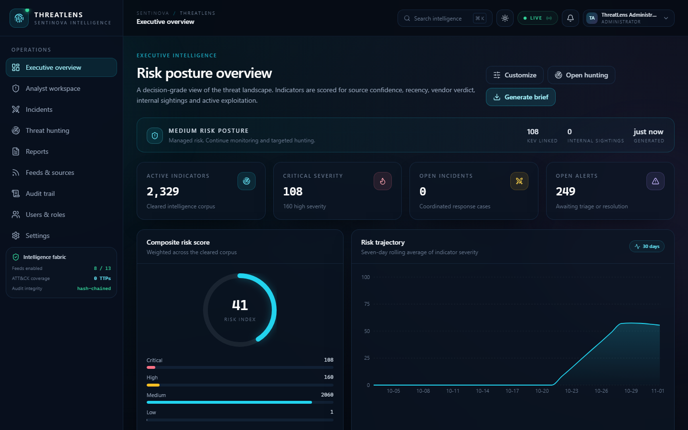
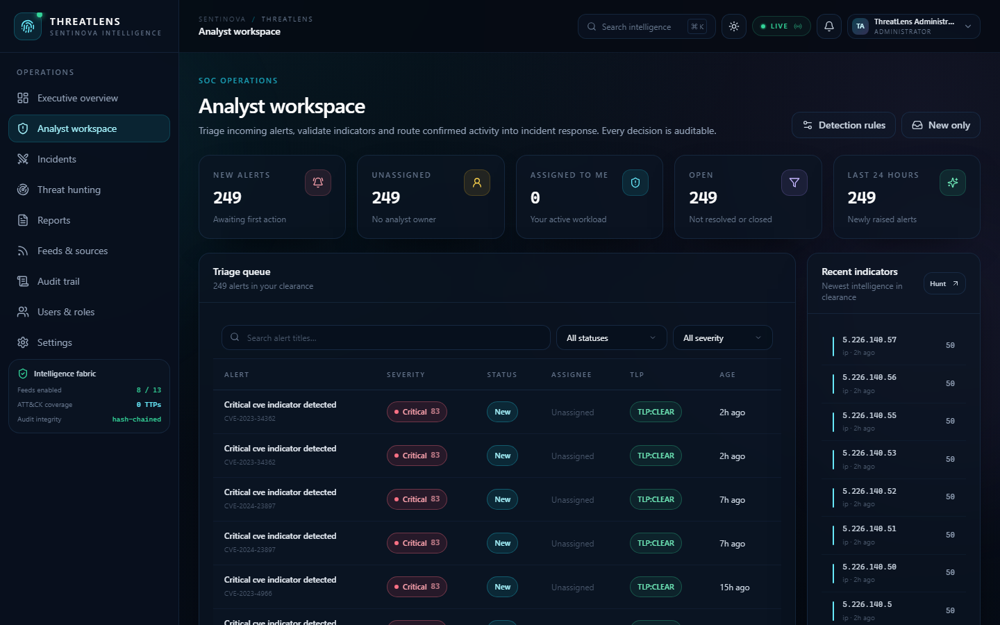
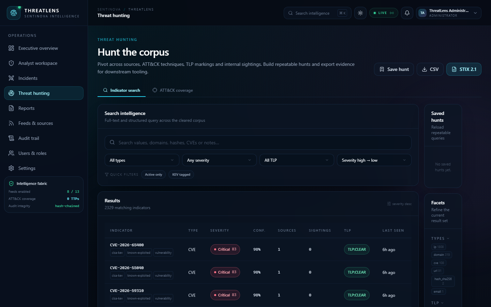

# Sentinova ThreatLens

ThreatLens is an evidence-first cyber threat intelligence platform that turns fragmented threat data into an auditable SOC workflow. It unifies indicator ingestion, normalization, risk scoring, correlation, ATT&CK-aligned hunting, incident response and executive reporting in one secure, deployable stack.

## Why ThreatLens stands out

ThreatLens goes beyond a basic IOC viewer or dashboard. It connects the full intelligence lifecycle—from ingestion and enrichment to investigation, response, audit and recovery—while keeping executive access aggregate-only. The repository includes reproducible security checks, browser-level validation, backup/restore evidence, container deployment and Kubernetes staging evidence alongside the application itself.



## Interface preview

| Analyst workspace | Threat hunting |
| --- | --- |
|  |  |

## Quick start (Windows)

```powershell
powershell -ExecutionPolicy Bypass -File .\run.ps1
```

The launcher creates `.env` from `.env.example` if needed, installs dependencies into `.venv`, builds the frontend when `frontend/dist` is missing, starts the API, and opens `http://127.0.0.1:8000`.

## Demo accounts

All demo users use password `ThreatLens#2026!`.

| Role | Email |
| --- | --- |
| Admin | `admin@threatlens.io` |
| Engineer | `engineer@threatlens.io` |
| Responder | `responder@threatlens.io` |
| Hunter | `hunter@threatlens.io` |
| Analyst | `analyst@threatlens.io` |
| Executive | `exec@threatlens.io` |

Executive accounts receive aggregate dashboards and reports without raw indicator values.

## Manual setup

Prerequisites: Python 3.11+ and Node.js 20+.

```powershell
py -3 -m venv .venv
.\.venv\Scripts\python.exe -m pip install --upgrade pip
.\.venv\Scripts\python.exe -m pip install -r requirements.txt
Copy-Item .env.example .env
Set-Location frontend
npm install
npm run build
Set-Location ..
.\.venv\Scripts\python.exe -m uvicorn app.main:app --app-dir backend --host 127.0.0.1 --port 8000
```

Open `http://127.0.0.1:8000`. Interactive API documentation is at `http://127.0.0.1:8000/api/docs`.

For frontend hot reload, run `npm run dev` in `frontend/` and keep the backend on port 8000. Vite proxies `/api` and `/api/v1/ws` to the backend.

## Production-profile Docker stack

The repository includes a multi-stage image and a Compose topology with PostgreSQL, Redis, Elasticsearch, the API, Celery worker/beat, and an nginx TLS reverse proxy.

```powershell
powershell -ExecutionPolicy Bypass -File .\deploy\generate-certs.ps1
docker compose build
docker compose up -d
```

Open `https://localhost:8443`. The self-signed certificate is intended for local evaluation; replace it with a trusted certificate before real use. Set `SECRET_KEY`, `POSTGRES_PASSWORD`, `CORS_ORIGINS`, and any feed keys in `.env` first.

Useful commands:

```powershell
docker compose ps
docker compose logs -f api worker beat nginx
docker compose --profile monitoring up -d
powershell -ExecutionPolicy Bypass -File .\deploy\backup.ps1
powershell -ExecutionPolicy Bypass -File .\deploy\restore.ps1 -InputFile .\data\backups\<file>.dump
```

Prometheus listens on `9090` and Grafana on `3000` when the `monitoring` profile is enabled. Kubernetes manifests under `deploy/k8s/` are render-validated with `kubectl kustomize` and have also been exercised on a single-node AWS k3s staging cluster. See `CLOUD_DEPLOYMENT_EVIDENCE.md` for the bounded acceptance evidence and limitations.

## What is included

- Indicator normalization, scoring, severity bands, TLP-aware access, enrichment, tagging, notes, and relationship views.
- Alert triage, workflow transitions, assignment, escalation, detection rules, and incident timelines.
- ATT&CK overlay, saved hunts, CSV/STIX export, world geo heatmap, and executive reporting with PDF output.
- Feed connectors, TAXII 2.1 collection ingestion, API-key-aware enrichment, scheduled jobs, notifications, audit ledger verification, user administration, and MFA.
- Hash-chained audit trail, append-only incident timeline, encrypted feed headers/MFA secrets, SSRF validation, signed webhooks, rate limiting, and security headers.
- Demo seed data covering six roles, 706 ATT&CK techniques, feeds, indicators, alerts, incidents, saved hunts, and a sample report.
- PostgreSQL/SQLite storage, Elasticsearch search projection with SQL fallback, Redis event fan-out, Celery worker/beat scheduling, and retention jobs.
- Docker Compose production profile with nginx TLS, Prometheus/Grafana monitoring, backup/restore scripts, and Kubernetes manifests.
- Light/dark themes and per-user dashboard widget preferences persisted through the profile API.
- Live shell metrics from the authenticated `/api/v1/meta` endpoint and route-level code splitting for the nine console pages.

## Verification

Run the complete verification suite from the project root:

```powershell
powershell -ExecutionPolicy Bypass -File .\verify.ps1
```

The script runs the backend tests, Ruff, Bandit, pip-audit, ESLint, the production build, npm audit, and the committed headless Chrome/Edge smoke test. It starts a temporary Uvicorn process only when port 8000 is free.

The backend test suite currently passes 188 tests. Ruff, Bandit, pip-audit, ESLint, the production build, npm audit, and the authenticated browser smoke test also pass. The browser pass loads all nine console routes without unexpected console, page, or request errors. The Compose stack has been smoke-tested through nginx with TLS login, Elasticsearch search, Redis-backed incident WebSocket delivery, Celery retention execution, and backup/restore verification.

## Configuration

Copy `.env.example` to `.env` and edit as needed. Important settings:

- `DEMO_MODE=true` seeds deterministic demo data. Set to `false` for a clean database.
- `SECRET_KEY` should be at least 32 characters in production. A private local development key is generated automatically when unset.
- `COOKIE_SECURE=true` and HTTPS are required in production.
- `CORS_ORIGINS` must include the frontend origin when running Vite separately.
- `DB_FILE` and `REPORTS_DIR` optionally relocate storage.
- `DATABASE_URL` selects PostgreSQL and overrides `DB_FILE`; leave blank for SQLite.
- `REDIS_URL` enables the Redis event bus. `CELERY_BROKER_URL`/`CELERY_RESULT_BACKEND` enable Celery.
- `ELASTICSEARCH_URL` enables Elasticsearch search; blank uses SQLite FTS or SQL fallback.
- `RUN_SCHEDULER=false` disables the in-process APScheduler when Celery beat is used.
- `RETENTION_DAYS` and `NOTIFICATION_RETENTION_DAYS` bound operational history without touching the audit ledger.
- Feed and enrichment keys are optional; missing keys fall back to transparent local demo behavior.
- `WEBHOOK_SECRET` enables `POST /api/v1/hooks/ingest` and must be at least 32 characters.

## Architecture

```text
backend/app/       FastAPI application, routers, services, seed data, jobs
backend/tests/     API, security, scoring, audit, and integration tests
frontend/src/      React console, typed API client, layouts, pages, components
data/              SQLite database, report files, bundled ATT&CK data
docs/              Change log and Windows setup guide
```

The embedded single-node profile uses SQLite with WAL and FTS5. The production-profile Compose stack adds PostgreSQL, Redis, Elasticsearch, Celery worker/beat, and nginx. Kubernetes manifests have been deployed to a single-node AWS k3s staging cluster; this is staging evidence, not a claim of multi-node production readiness.

## Operational notes

- Demo indicators use reserved documentation IP ranges and `example.com` domains. Geolocation is explicitly marked as simulated.
- Live connectors require outbound network access and valid API keys.
- Use a reverse proxy with TLS, restrict network exposure, back up `data/`, and rotate `SECRET_KEY` and webhook secrets before any real deployment.
- The audit chain detects accidental or casual tampering; it is not an external immutable ledger.

## Documentation

- `docs/ThreatLens_Change_Log.docx`
- `docs/ThreatLens_Windows_Setup_Guide.docx`
- `docs/ThreatLens_Setup_and_Run_Guide.docx`
- `deploy/README.md` for Compose, TLS, monitoring, backup, and Kubernetes notes.
- `CLOUD_DEPLOYMENT_EVIDENCE.md` for the sanitized AWS staging acceptance record.
- `docs/EVIDENCE_SUMMARY.md` for concise public verification evidence.
- `docs/PRD_COMPLIANCE.md` for implemented scope and remaining non-functional validation.

